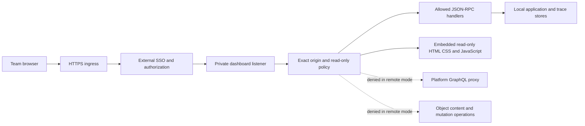

# High-level architecture

## Intended outcome

Provide authorized team members with read-only access to the development
daemon's application status and stored traces through an internal HTTPS hostname.
Keep deployment and infrastructure management in existing systems. M1 implements
request restrictions; it does not install ingress, authenticate users, or connect
the daemon to production applications.

The diagram describes the required deployment topology. The ingress and SSO
components are external. Remote UI assets are embedded in the CLI release.
There is no deployed-application registry or runtime collector in this milestone.

## Boundaries

| Component | Responsibility | Boundary |
| --- | --- | --- |
| HTTPS ingress and SSO proxy | Authenticate every request; authorize the intended team | Entire listener, including HTML, assets, deep links and WebSocket upgrades |
| Dashboard policy | Validate configured browser origins and restrict methods/routes/RPCs | Defense in depth; never an identity check |
| Dashboard handlers | Return allowed local status and trace data | No SQL execution, app API invocation, file opening or mutation in remote mode |
| Embedded remote UI | Show local apps, status and stored traces through allowed RPCs | Same-origin assets and WebSocket; no Cloud frontend or authentication SDK |
| Local daemon stores | Hold registered local apps and traces | Not a production fleet inventory or tenant isolation boundary |
| Dokploy | Own runtime configuration, ingress and image deployment | No competing configuration authority introduced |

## Origin checks do not authenticate

`Origin` describes a browser request context. A non-browser client can omit or
forge it. Remote mode permits a missing Origin for trusted proxy and non-browser
traffic; therefore its listener must be reachable only through an authenticated,
authorized proxy and explicitly trusted internal paths.

Do not publish the dashboard container port directly or attach an unprotected
alternate domain. Do not treat `X-Forwarded-User`, `X-Auth-Request-Email` or another
client-provided identity header as authentication inside the daemon. The SSO
layer must authenticate its own session and enforce its own authorization policy.

If exact organization email-domain authorization is required, verify it in the
proxy. An identity provider's organization-only audience alone may admit multiple
organization domains. Scope the gate to this service; leave unrelated public
hosts and existing identity consumers unchanged.

All SSO-admitted users see all apps and traces registered in this daemon workspace.
Read-only access still exposes potentially sensitive trace payloads and metadata.
M1 does not add redaction, per-app authorization or tenant isolation. It suppresses
raw process stdout/stderr notifications, but other metadata and trace notifications
remain. M2 browser/SSO trials must use isolated development data, never production
data.

Forward authentication gates a WebSocket handshake. It does not by itself revoke
an already open socket when the browser logs out or its SSO session expires.
Session lifetime, logout behavior and any required connection expiration policy
must be explicitly accepted in M2 before the listener serves sensitive data.

## Local and remote modes

- **Unset remote-origin configuration:** existing local behavior remains the
  default. This is not the safe fallback for a publicly reachable listener.
- **Valid remote-origin configuration:** remote restrictions apply to the whole
  listener, including requests with no Origin and requests from localhost.
- **Invalid present configuration:** daemon startup fails before opening listeners.

Binding to a non-loopback interface and opting into remote restrictions are
separate configuration choices. Remote mode does not prove that an SSO proxy is
installed or that alternate ingress is closed.

## UI and platform dependency

Remote mode serves the fork's [embedded assets](../../cli/daemon/dash/remoteui).
The browser obtains HTML, CSS and JavaScript from the protected dashboard origin
and connects to `/__encore` on that same origin. HTTPS pages use `wss://` directly.
The remote handler does not instantiate the hosted frontend or platform API
proxy, and the remote package has no frontend-upstream setting. The existing
local mode continues using its original
[frontend proxy](../../cli/daemon/dash/dashproxy/dashproxy.go) and configuration.

The original deployment proxied a hosted UI that selected the Cloud application
for a custom hostname. Its Cloud authentication SDK was configured for the
upstream domain, leaving the page at a loading spinner. The earlier CSP
`upgrade-insecure-requests` workaround addressed legacy HTTP/WebSocket URLs; it
could not change that application selection or authentication-domain binding.
Serving HTML and scripts successfully was therefore insufficient acceptance.

The replacement presents the daemon's local app list, status and stored traces.
A fresh workspace explicitly says no apps are registered; it does not pretend
to discover existing Dokploy services. Empty, disconnected and request-error
states must be visible rather than leaving an indefinite loading indicator.
Cloud GraphQL, mutations and object content stay denied. Do not widen the RPC
allowlist to reproduce Cloud-only screens.

This removes the remote UI's Cloud frontend/authentication dependency. It does
not claim all CLI code paths are offline: the daemon retains periodic outbound
Encore release checks, independent of UI startup. Browser read views, deep links, WebSocket reconnection and
SSO session behavior still require M2 acceptance on the selected release.

## Future deployed-app observation

M4 may introduce a registry of immutable application/build/environment identities
and a scoped metadata/trace ingestion interface. That requires an explicit
protocol, retention policy, credentials, authorization and consistency model.
An optional collector can be considered then. Running the development daemon in
a container does not make these capabilities available today.
