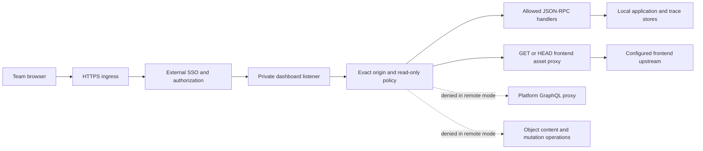

# High-level architecture

## Intended outcome

Provide authorized team members with read-only access to the development
daemon's application status and stored traces through an internal HTTPS hostname.
Keep deployment and infrastructure management in existing systems. M1 implements
request restrictions; it does not install ingress, authenticate users, or connect
the daemon to production applications.

The diagram describes the required deployment topology. The ingress and SSO
components are not delivered by M1. The frontend upstream remains a dependency.
There is no deployed-application registry or runtime collector in this milestone.

## Boundaries

| Component | Responsibility | Boundary |
| --- | --- | --- |
| HTTPS ingress and SSO proxy | Authenticate every request; authorize the intended team | Entire listener, including HTML, assets, deep links and WebSocket upgrades |
| Dashboard policy | Validate configured browser origins and restrict methods/routes/RPCs | Defense in depth; never an identity check |
| Dashboard handlers | Return allowed local status and trace data | No SQL execution, app API invocation, file opening or mutation in remote mode |
| Frontend proxy | Serve the existing UI through its configured upstream | Only asset request headers forwarded; upstream cookies stripped; UI compatibility unverified |
| Local daemon stores | Hold registered local apps and traces | Not a production fleet inventory or tenant isolation boundary |
| Dokploy | Own runtime configuration, ingress and image deployment | No competing configuration authority introduced |

## Origin checks do not authenticate

`Origin` describes a browser request context. A non-browser client can omit or
forge it. Remote mode permits a missing Origin for trusted proxy and non-browser
traffic; therefore its listener must be reachable only through an authenticated,
authorized proxy and explicitly trusted internal paths.

Do not publish the dashboard container port directly or attach an unprotected
alternate domain. Do not treat `X-Forwarded-User`, `X-Auth-Request-Email` or another
client-provided identity header as authentication inside the daemon. The SSO
layer must authenticate its own session and enforce its own authorization policy.

If exact organization email-domain authorization is required, verify it in the
proxy. An identity provider's organization-only audience alone may admit multiple
organization domains. Scope the gate to this service; leave unrelated public
hosts and existing identity consumers unchanged.

All SSO-admitted users see all apps and traces registered in this daemon workspace.
Read-only access still exposes potentially sensitive trace payloads and metadata.
M1 does not add redaction, per-app authorization or tenant isolation. It suppresses
raw process stdout/stderr notifications, but other metadata and trace notifications
remain. M2 browser/SSO trials must use isolated development data, never production
data.

Forward authentication gates a WebSocket handshake. It does not by itself revoke
an already open socket when the browser logs out or its SSO session expires.
Session lifetime, logout behavior and any required connection expiration policy
must be explicitly accepted in M2 before the listener serves sensitive data.

## Local and remote modes

- **Unset remote-origin configuration:** existing local behavior remains the
  default. This is not the safe fallback for a publicly reachable listener.
- **Valid remote-origin configuration:** remote restrictions apply to the whole
  listener, including requests with no Origin and requests from localhost.
- **Invalid present configuration:** daemon startup fails before opening listeners.

Binding to a non-loopback interface and opting into remote restrictions are
separate configuration choices. Remote mode does not prove that an SSO proxy is
installed or that alternate ingress is closed.

## UI and platform dependency

The dashboard server currently proxies ordinary frontend paths to
`ENCORE_DEVDASH_URL`, whose default is `https://devdash.encore.dev`.
In remote mode the asset proxy forwards only a minimal asset-header allowlist;
cookies, authorization, SSO identity and forwarded-client headers do not reach
the upstream. Upstream `Set-Cookie` is removed. This protects the proxy boundary,
but does not make fetched JavaScript an untrusted or isolated component: frontend
code still runs under the dashboard origin and needs a separate trust review.
The proxy caches responses, but a cache is not a reproducible frontend build or
an air-gap guarantee. See [configuration](../../internal/conf/conf.go) and
[frontend proxy](../../cli/daemon/dash/dashproxy/dashproxy.go).

Remote mode blocks `/__graphql`, which otherwise forwards through the
[platform API proxy](../../cli/daemon/dash/apiproxy/apiproxy.go). The existing UI
may depend on that route or on disallowed RPCs. Browser behavior, login redirects,
deep links, WebSocket reconnection and useful read views must be verified in M2.
Do not widen the allowlist to make an unreviewed UI request succeed.

## Future deployed-app observation

M4 may introduce a registry of immutable application/build/environment identities
and a scoped metadata/trace ingestion interface. That requires an explicit
protocol, retention policy, credentials, authorization and consistency model.
An optional collector can be considered then. Running the development daemon in
a container does not make these capabilities available today.
