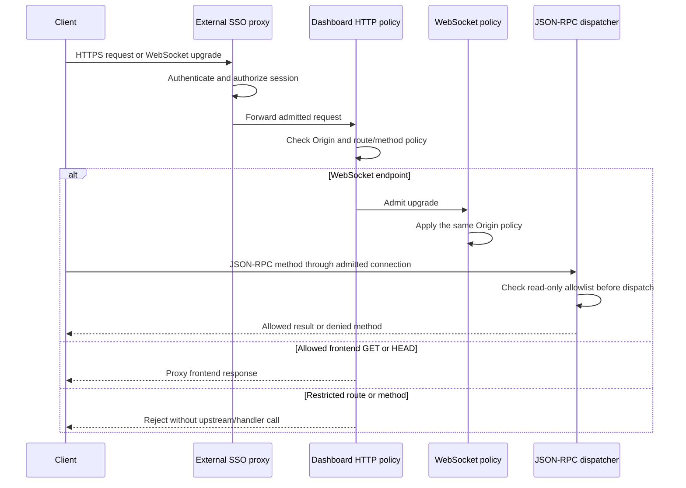

# Low-level design

This document defines the M1 contract. Verification status is tracked in the
[checklist](checklist.md); documented behavior is not a claim of a successful
deployment or browser acceptance test.

## Configuration contract

`ENCORE_DEVDASH_REMOTE_ORIGINS` is opt-in and contains a nonempty JSON array of
exact HTTPS origins. Example syntax, using a reserved example domain:

```text
ENCORE_DEVDASH_REMOTE_ORIGINS=["https://dashboard.example.com"]
```

An origin contains a scheme, host and optional port. It contains no credentials,
path, query, fragment, wildcard or domain suffix pattern. HTTP origins and the
literal `null` are not remote origins. Hostname case and the default HTTPS port
443 are normalized; non-default ports remain distinct. Equivalent duplicate
origins are rejected. Internationalized hostnames must use their ASCII/punycode
form; IPv6 literals require brackets and cannot contain a zone identifier.

| Configuration | Result |
| --- | --- |
| Variable absent | Existing local behavior |
| Valid nonempty array | Remote mode with exact allowed origins |
| Present empty string, empty array or malformed JSON | Startup failure |
| Non-string elements or an invalid origin | Startup failure |
| Duplicate origins after canonicalization | Startup failure |

Parse and validate once during daemon initialization, before any listener opens.
Keep the resulting policy immutable for the server lifetime. A configuration
change requires a controlled process restart. Include the value in the daemon
configuration hash, but do not claim automatic restart: source/develop builds
can reuse a daemon despite a hash mismatch in
[ConnectDaemon](../../cli/cmd/encore/cmdutil/daemon.go). Explicitly restart a
foreground daemon, and redeploy after changing Dokploy configuration.
Error output must identify invalid
configuration without dumping environment values or credentials.

## Request path



The actual implementation must enforce the same origin decision for ordinary
HTTP and WebSocket upgrades. A missing Origin is allowed for proxy/non-browser
traffic; a present malformed or non-allowlisted Origin is denied. Multiple Origin
headers are rejected in both modes, deliberately tightening malformed local
requests. Remote requests marked `Sec-Fetch-Site: cross-site` are also denied. Remote mode
must not inherit a general localhost exception. Policy decisions must occur
before a protected handler or upstream proxy can perform work.

## Remote HTTP surface

| Surface | Remote behavior |
| --- | --- |
| `/__encore` | WebSocket protocol subject to shared origin policy and RPC allowlist |
| `/__graphql` | Denied; no use of the daemon's machine account/platform token |
| `/__encore/objects/content` | Denied |
| Frontend proxy paths | GET and HEAD only, after origin policy |
| Other methods on frontend paths | Denied before forwarding |

Restrictions apply regardless of whether Origin is present. New route additions
must be reviewed against this boundary instead of inheriting local capabilities.

For remote static assets, build outbound headers from an allowlist containing
content negotiation, cache validation and range headers only. Do not forward
Authorization, cookies, SSO identity headers, forwarded-client headers or arbitrary
custom headers. Strip `Set-Cookie` from the upstream response. Verify this behavior
against a local capture server, including responses served through the proxy cache.

## Remote JSON-RPC allowlist

Only these exact methods are admitted:

```text
version
list-apps
status
onboarding/get
traces/list
traces/get
traces/spans/summaries/list
traces/spans/events/list
```

Every other method, including future methods, is denied before handler execution.
Examples include SQL query/transaction, app API calls, trace clearing, onboarding
updates, telemetry submissions, editor integration and object operations.
`onboarding/get` is retained as an existing read dependency, not permission to
change onboarding state. Remote notification delivery suppresses `process/output`
(raw process stdout/stderr); local delivery is unchanged. Other metadata and trace
notifications remain visible to every admitted remote user. Notifications and
connection lifecycle need review when changing the observable data surface.

The local dispatcher remains the source of behavior for the allowed methods;
M1 does not implement a second trace engine or copy stored data into a new system.
See [JSON-RPC dispatch](../../cli/daemon/dash/dash.go) and
[HTTP/WebSocket serving](../../cli/daemon/dash/server.go).

## Packaging contract

The source-built CLI, runtime sources and patched Go toolchain are separate
inputs. Pin their identities for a releasable package. The CLI version must identify
the fork commit rather than impersonating an upstream release. Rust supervisor/JS runtime
binaries are additional inputs when the selected functionality requires them.
Do not invoke the upstream release uploader as a local build shortcut; it writes
to upstream release storage. See [release tooling](../../pkg/releaser/README.md).

The dashboard container needs explicit ownership of its daemon state and cache.
M2 must define persistent paths, permissions, backup/retention expectations and
which local apps may be registered. Do not mount a production Docker socket,
application credentials or unrelated workspaces merely to make discovery work.

## Failure and rollback

Invalid configuration fails closed at startup. Disallowed HTTP requests and RPCs
must return an error without invoking the underlying operation. SSO failure must
leave protected content inaccessible, not route around the proxy.

Rollback order: remove/disable target ingress or restore the previous protected
route, then restore the known image/configuration. Never unset remote restrictions
while retaining remotely reachable ingress: unset selects the more capable local
mode. Do not remove shared identity infrastructure. Preserve private target
before-state and reconcile uncertain deployment outcomes before another write.
